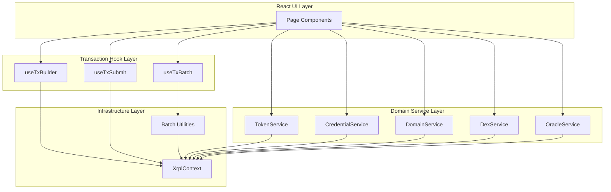
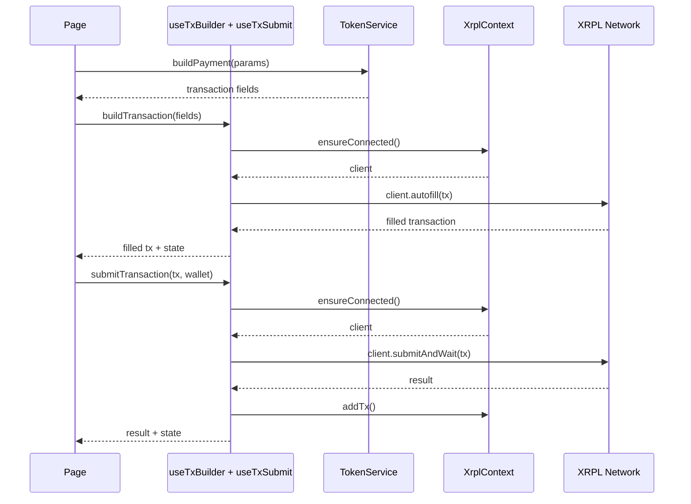
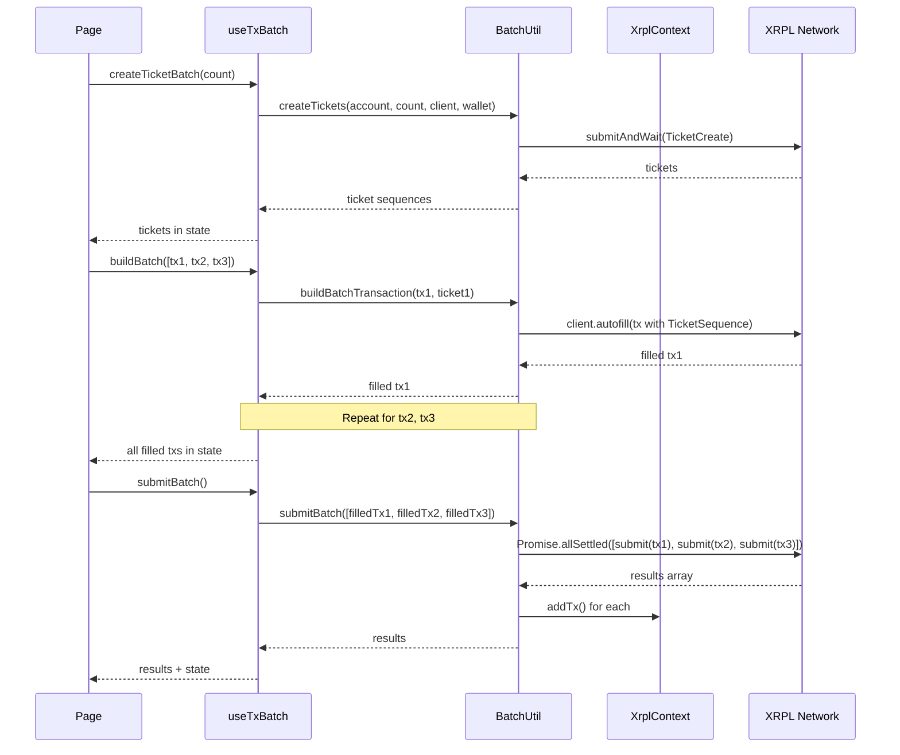

# Design Document: XRPL Transaction Batching Refactor

## Overview

This design specifies the architecture for refactoring the XRPL client's transaction handling from 50+ inline `submitAndWait` calls into a modular, testable, and maintainable system. The refactor introduces three core abstractions:

1. **Ticket-based batching infrastructure** for parallel transaction submission
2. **Transaction hooks** (`useTxBuilder`, `useTxSubmit`, `useTxBatch`) for reusable state management
3. **Domain service modules** (TokenService, CredentialService, DexService, etc.) for business logic encapsulation

The design maintains backward compatibility—all existing single-transaction flows continue to work unchanged. Batching is opt-in and requires explicit adoption of the new hooks.

### Key Design Principles

- **Separation of concerns**: Services build transactions, hooks manage state, React components render UI
- **Testability**: Services are pure functions with dependency injection; hooks expose state for testing
- **Progressive adoption**: Developers can migrate page-by-page from legacy patterns to new patterns
- **Zero breaking changes**: XrplContext API remains unchanged; existing pages work without modification

## Architecture

### System Overview



### Data Flow: Single Transaction



### Data Flow: Batch Transaction



## Components and Interfaces

### 1. Batch Utilities Module

**Location**: `src/utils/batch.js`

Provides stateless functions for ticket-based batching.

```javascript
/**
 * Create tickets for batch transaction submission.
 * @param {string} account - Account address creating tickets
 * @param {number} count - Number of tickets to create (2-250)
 * @param {Client} client - Connected xrpl.Client instance
 * @param {Wallet} wallet - xrpl.Wallet for signing
 * @returns {Promise<number[]>} Array of ticket sequence numbers
 * @throws {Error} If count is out of range or TicketCreate fails
 */
export async function createTickets(account, count, client, wallet)

/**
 * Build a transaction using a Ticket sequence.
 * @param {object} txFields - Transaction fields (TransactionType, Account, etc.)
 * @param {number} ticketSequence - Ticket sequence to use
 * @param {Client} client - Connected xrpl.Client instance
 * @returns {Promise<object>} Autofilled transaction with TicketSequence set
 */
export async function buildBatchTransaction(txFields, ticketSequence, client)

/**
 * Submit multiple transactions in parallel.
 * @param {object[]} transactions - Array of signed transaction objects
 * @param {Client} client - Connected xrpl.Client instance
 * @param {Wallet} wallet - xrpl.Wallet for signing
 * @param {function} onTxComplete - Callback(txHash) called for each completion
 * @returns {Promise<object[]>} Array of result objects: { success, hash, error, index }
 */
export async function submitBatch(transactions, client, wallet, onTxComplete)
```

**Implementation Details**:

- `createTickets`: Submits `TicketCreate` with `TicketCount` field, extracts ticket sequences from metadata
- `buildBatchTransaction`: Sets `TicketSequence` field, omits `Sequence` field, calls `client.autofill()`, then forces `TicketSequence` back (autofill may overwrite)
- `submitBatch`: Uses `Promise.allSettled()` for parallel submission; maps results to success/failure objects

### 2. Transaction Builder Hook

**Location**: `src/hooks/transactions/useTxBuilder.js`

Encapsulates transaction autofill logic for single transactions.

```javascript
/**
 * Hook for building and autofilling XRPL transactions.
 * @param {object} txFields - Transaction fields to autofill
 * @returns {object} { builtTx, building, error, buildTransaction }
 */
export function useTxBuilder() {
  const { ensureConnected } = useXrpl()
  const [builtTx, setBuiltTx] = useState(null)
  const [building, setBuilding] = useState(false)
  const [error, setError] = useState('')

  const buildTransaction = useCallback(async (txFields) => {
    setBuilding(true)
    setError('')
    setBuiltTx(null)
    try {
      const client = await ensureConnected()
      const filled = await client.autofill(txFields)
      setBuiltTx(filled)
      return filled
    } catch (e) {
      setError(e.message)
      return null
    } finally {
      setBuilding(false)
    }
  }, [ensureConnected])

  return { builtTx, building, error, buildTransaction }
}
```

**State**:
- `builtTx`: Autofilled transaction object or null
- `building`: Boolean indicating autofill in progress
- `error`: Error message string

**Functions**:
- `buildTransaction(txFields)`: Autofills transaction, updates state, returns filled tx

### 3. Transaction Submit Hook

**Location**: `src/hooks/transactions/useTxSubmit.js`

Encapsulates transaction submission logic for single transactions.

```javascript
/**
 * Hook for submitting XRPL transactions.
 * @returns {object} { result, submitting, error, success, submitTransaction }
 */
export function useTxSubmit() {
  const { xrpl, wallet, ensureConnected, addTx } = useXrpl()
  const [result, setResult] = useState(null)
  const [submitting, setSubmitting] = useState(false)
  const [error, setError] = useState('')

  const submitTransaction = useCallback(async (transaction, walletSeed) => {
    setSubmitting(true)
    setError('')
    setResult(null)
    try {
      const client = await ensureConnected()
      const w = xrpl.Wallet.fromSeed(walletSeed || wallet.seed)
      const res = await client.submitAndWait(transaction, { wallet: w })
      setResult(res)
      addTx()
      return res
    } catch (e) {
      setError(e.message)
      return null
    } finally {
      setSubmitting(false)
    }
  }, [xrpl, wallet, ensureConnected, addTx])

  const success = result?.result?.meta?.TransactionResult === 'tesSUCCESS'

  return { result, submitting, error, success, submitTransaction }
}
```

**State**:
- `result`: Full submitAndWait response object or null
- `submitting`: Boolean indicating submission in progress
- `error`: Error message string
- `success`: Derived boolean from TransactionResult

**Functions**:
- `submitTransaction(transaction, walletSeed?)`: Submits transaction, updates history, returns result

### 4. Batch Transaction Hook

**Location**: `src/hooks/transactions/useTxBatch.js`

Manages state for ticket creation, batch building, and batch submission.

```javascript
/**
 * Hook for ticket-based batch transaction workflows.
 * @returns {object} Hook state and functions
 */
export function useTxBatch() {
  const { xrpl, wallet, ensureConnected, addTx } = useXrpl()
  
  // Ticket state
  const [tickets, setTickets] = useState([])
  const [ticketLoading, setTicketLoading] = useState(false)
  const [ticketError, setTicketError] = useState('')
  
  // Batch build state
  const [builtBatch, setBuiltBatch] = useState([])
  const [batchLoading, setBatchLoading] = useState(false)
  const [batchError, setBatchError] = useState('')
  
  // Submit state
  const [results, setResults] = useState([])
  const [submitLoading, setSubmitLoading] = useState(false)
  const [submitError, setSubmitError] = useState('')

  const createTicketBatch = useCallback(async (count) => {
    if (count < 2 || count > 250) {
      setTicketError('Ticket count must be 2-250')
      return null
    }
    setTicketLoading(true)
    setTicketError('')
    try {
      const client = await ensureConnected()
      const w = xrpl.Wallet.fromSeed(wallet.seed)
      const ticketSequences = await createTickets(wallet.address, count, client, w)
      setTickets(ticketSequences)
      return ticketSequences
    } catch (e) {
      setTicketError(e.message)
      return null
    } finally {
      setTicketLoading(false)
    }
  }, [wallet, ensureConnected, xrpl])

  const buildBatch = useCallback(async (txFieldsArray) => {
    if (txFieldsArray.length > tickets.length) {
      setBatchError('Not enough tickets for batch size')
      return null
    }
    setBatchLoading(true)
    setBatchError('')
    try {
      const client = await ensureConnected()
      const built = []
      for (let i = 0; i < txFieldsArray.length; i++) {
        const filled = await buildBatchTransaction(txFieldsArray[i], tickets[i], client)
        built.push(filled)
      }
      setBuiltBatch(built)
      return built
    } catch (e) {
      setBatchError(e.message)
      return null
    } finally {
      setBatchLoading(false)
    }
  }, [tickets, ensureConnected])

  const submitBatch = useCallback(async () => {
    if (builtBatch.length === 0) {
      setSubmitError('No transactions to submit')
      return null
    }
    setSubmitLoading(true)
    setSubmitError('')
    try {
      const client = await ensureConnected()
      const w = xrpl.Wallet.fromSeed(wallet.seed)
      const batchResults = await submitBatch(builtBatch, client, w, () => addTx())
      setResults(batchResults)
      return batchResults
    } catch (e) {
      setSubmitError(e.message)
      return null
    } finally {
      setSubmitLoading(false)
    }
  }, [builtBatch, wallet, ensureConnected, xrpl, addTx])

  const reset = useCallback(() => {
    setTickets([])
    setBuiltBatch([])
    setResults([])
    setTicketError('')
    setBatchError('')
    setSubmitError('')
  }, [])

  return {
    // Ticket state
    tickets, ticketLoading, ticketError, createTicketBatch,
    // Batch build state
    builtBatch, batchLoading, batchError, buildBatch,
    // Submit state
    results, submitLoading, submitError, submitBatch,
    // Utilities
    reset,
  }
}
```

**State Management**:
- Ticket creation: `tickets`, `ticketLoading`, `ticketError`
- Batch building: `builtBatch`, `batchLoading`, `batchError`
- Batch submission: `results`, `submitLoading`, `submitError`

**Workflow Functions**:
- `createTicketBatch(count)`: Creates tickets and stores sequences
- `buildBatch(txFieldsArray)`: Builds transactions using tickets
- `submitBatch()`: Submits built batch in parallel
- `reset()`: Clears all batch state

### 5. Token Service

**Location**: `src/services/TokenService.js`

Encapsulates fungible token (FT), NFT, and Multi-Purpose Token (MPT) operations.

```javascript
/**
 * Token service for FT, NFT, and MPT operations.
 * All functions return plain transaction field objects ready for autofill.
 */

import * as xrpl from 'xrpl'

/**
 * Build AccountSet transaction for issuer configuration.
 */
export function buildConfigureIssuer({
  account,
  setFlag,        // e.g., 'asfDefaultRipple'
  clearFlag,      // optional
  transferRate,   // 0-100 (percent)
  tickSize,       // 3-15 or 0 for off
  domain,         // lowercase domain string
  emailHash,      // MD5 hex
  messageKey,     // hex public key
}) {
  const tx = {
    TransactionType: 'AccountSet',
    Account: account,
  }
  
  const ASF_MAP = {
    asfRequireDestTag: 1, asfRequireAuth: 2, asfDisallowXRP: 3,
    asfDisableMaster: 4, asfAccountTxnID: 5, asfNoFreeze: 6,
    asfGlobalFreeze: 7, asfDefaultRipple: 8, asfDepositAuth: 9,
    asfAllowTrustLineClawback: 16,
  }
  
  if (setFlag && setFlag !== 'none') tx.SetFlag = ASF_MAP[setFlag]
  if (clearFlag && clearFlag !== 'none') tx.ClearFlag = ASF_MAP[clearFlag]
  if (transferRate !== undefined && transferRate !== null) {
    tx.TransferRate = transferRate === 0 
      ? 0 
      : Math.round(transferRate * 10_000_000 + 1_000_000_000)
  }
  if (tickSize) tx.TickSize = tickSize
  if (domain) tx.Domain = xrpl.convertStringToHex(domain.toLowerCase())
  if (emailHash) tx.EmailHash = emailHash
  if (messageKey) tx.MessageKey = messageKey
  
  return tx
}

/**
 * Build Payment transaction for fungible token distribution.
 */
export function buildDistributeFungibleToken({
  account,
  destination,
  currency,
  amount,
  partial,       // boolean for tfPartialPayment
  sendMax,       // optional for partial
  deliverMin,    // optional for partial
  destinationTag,
  memo,
}) {
  const tx = {
    TransactionType: 'Payment',
    Account: account,
    Destination: destination,
    Amount: {
      currency: currency.toUpperCase(),
      issuer: account,
      value: amount,
    },
  }
  
  if (partial) {
    tx.Flags = 0x00020000 // tfPartialPayment
    if (sendMax) {
      tx.SendMax = { currency: currency.toUpperCase(), issuer: account, value: sendMax }
    }
    if (deliverMin) {
      tx.DeliverMin = { currency: currency.toUpperCase(), issuer: account, value: deliverMin }
    }
  }
  
  if (destinationTag) tx.DestinationTag = destinationTag
  if (memo) tx.Memos = [{ Memo: { MemoData: xrpl.convertStringToHex(memo) } }]
  
  return tx
}

/**
 * Build TrustSet transaction for authorizing holder's trust line (issuer side).
 */
export function buildAuthorizeTrustLine({
  account,
  holderAddress,
  currency,
}) {
  return {
    TransactionType: 'TrustSet',
    Account: account,
    LimitAmount: {
      currency: currency.toUpperCase(),
      issuer: holderAddress,
      value: '0',
    },
    Flags: 0x00010000, // tfSetfAuth
  }
}

/**
 * Build Clawback transaction for reclaiming issued tokens.
 */
export function buildClawbackToken({
  account,
  holderAddress,
  currency,
  amount,
}) {
  return {
    TransactionType: 'Clawback',
    Account: account,
    Amount: {
      currency: currency.toUpperCase(),
      issuer: holderAddress, // holder is Amount.issuer when issuer claws back
      value: amount,
    },
  }
}

/**
 * Build NFTokenMint transaction.
 */
export function buildMintNFT({
  account,
  taxon,
  uri,
  transferFee,   // 0-50 (percent)
  flags,         // { burnable, onlyXRP, transferable, mutable }
  issuer,        // optional for minting on behalf of another account
}) {
  const tx = {
    TransactionType: 'NFTokenMint',
    Account: account,
    NFTokenTaxon: taxon,
    Flags: 0,
  }
  
  if (flags.burnable) tx.Flags |= 0x00000001
  if (flags.onlyXRP) tx.Flags |= 0x00000002
  if (flags.transferable) tx.Flags |= 0x00000008
  if (flags.mutable) tx.Flags |= 0x00000010
  
  if (transferFee && transferFee > 0) {
    tx.TransferFee = Math.round(transferFee * 1000)
  }
  if (uri) tx.URI = xrpl.convertStringToHex(uri)
  if (issuer) tx.Issuer = issuer
  
  return tx
}

/**
 * Build NFTokenCreateOffer transaction (sell or buy).
 */
export function buildCreateNFTOffer({
  account,
  nftokenID,
  amount,        // { currency, issuer?, value } or drops string
  isSellOffer,   // boolean
  destination,   // optional for sell offers
  owner,         // required for buy offers
  expiration,    // optional Date object
}) {
  const tx = {
    TransactionType: 'NFTokenCreateOffer',
    Account: account,
    NFTokenID: nftokenID,
    Amount: amount,
  }
  
  if (isSellOffer) {
    tx.Flags = 1 // tfSellNFToken
    if (destination) tx.Destination = destination
  } else {
    if (!owner) throw new Error('Owner required for buy offers')
    tx.Owner = owner
  }
  
  if (expiration) {
    tx.Expiration = Math.floor(expiration.getTime() / 1000) - 946684800
  }
  
  return tx
}

/**
 * Build NFTokenAcceptOffer transaction.
 */
export function buildAcceptNFTOffer({
  account,
  sellOfferID,   // optional
  buyOfferID,    // optional
  brokerFee,     // optional, requires both IDs
}) {
  const tx = {
    TransactionType: 'NFTokenAcceptOffer',
    Account: account,
  }
  
  if (sellOfferID) tx.NFTokenSellOffer = sellOfferID
  if (buyOfferID) tx.NFTokenBuyOffer = buyOfferID
  if (brokerFee && sellOfferID && buyOfferID) {
    tx.NFTokenBrokerFee = xrpl.xrpToDrops(brokerFee)
  }
  
  return tx
}

/**
 * Build NFTokenCancelOffer transaction.
 */
export function buildCancelNFTOffer({
  account,
  offerIDs, // array of offer ID strings
}) {
  return {
    TransactionType: 'NFTokenCancelOffer',
    Account: account,
    NFTokenOffers: offerIDs,
  }
}

/**
 * Build NFTokenBurn transaction.
 */
export function buildBurnNFT({
  account,
  nftokenID,
}) {
  return {
    TransactionType: 'NFTokenBurn',
    Account: account,
    NFTokenID: nftokenID,
  }
}

/**
 * Build MPTokenIssuanceCreate transaction.
 */
export function buildCreateMPT({
  account,
  maxAmount,     // optional max supply
  assetScale,    // 0-19
  transferFee,   // 0-50000 (basis points)
  metadata,      // optional hex string
  flags,         // { lockable, transferable }
}) {
  const tx = {
    TransactionType: 'MPTokenIssuanceCreate',
    Account: account,
  }
  
  if (maxAmount) tx.MaximumAmount = maxAmount
  if (assetScale !== undefined) tx.AssetScale = assetScale
  if (transferFee) tx.TransferFee = transferFee
  if (metadata) tx.MPTokenMetadata = metadata
  
  let flagValue = 0
  if (flags?.lockable) flagValue |= 0x0001
  if (flags?.transferable) flagValue |= 0x0002
  if (flagValue > 0) tx.Flags = flagValue
  
  return tx
}

/**
 * Build MPTokenAuthorize transaction for holder authorization.
 */
export function buildAuthorizeMPT({
  account,
  mptIssuanceID,
  holderAddress, // optional, issuer can authorize self
}) {
  const tx = {
    TransactionType: 'MPTokenAuthorize',
    Account: account,
    MPTokenIssuanceID: mptIssuanceID,
  }
  
  if (holderAddress) tx.Holder = holderAddress
  
  return tx
}

/**
 * Build Payment transaction for MPT distribution.
 */
export function buildDistributeMPT({
  account,
  destination,
  mptIssuanceID,
  amount,
  destinationTag,
  memo,
}) {
  const tx = {
    TransactionType: 'Payment',
    Account: account,
    Destination: destination,
    Amount: {
      mpt_issuance_id: mptIssuanceID,
      value: amount,
    },
  }
  
  if (destinationTag) tx.DestinationTag = destinationTag
  if (memo) tx.Memos = [{ Memo: { MemoData: xrpl.convertStringToHex(memo) } }]
  
  return tx
}

/**
 * Build MPTokenIssuanceDestroy transaction.
 */
export function buildDestroyMPT({
  account,
  mptIssuanceID,
}) {
  return {
    TransactionType: 'MPTokenIssuanceDestroy',
    Account: account,
    MPTokenIssuanceID: mptIssuanceID,
  }
}
```

**Design Notes**:
- All functions return plain transaction field objects (no side effects)
- Functions accept destructured parameter objects for clarity
- Currency codes are normalized to uppercase
- Hex encoding handled by xrpl library functions
- No direct dependency on React or XrplContext

### 6. Credential Service

**Location**: `src/services/CredentialService.js`

```javascript
/**
 * Credential service for Permissioned DEX credential operations.
 */

import * as xrpl from 'xrpl'

/**
 * Build CredentialCreate transaction.
 */
export function buildCreateCredential({
  account,
  subject,
  credentialType,
  expiration,  // optional Date object
  uri,         // optional
}) {
  const tx = {
    TransactionType: 'CredentialCreate',
    Account: account,
    Subject: subject,
    CredentialType: xrpl.convertStringToHex(credentialType),
  }
  
  if (expiration) {
    tx.Expiration = Math.floor(expiration.getTime() / 1000) - 946684800
  }
  if (uri) tx.URI = xrpl.convertStringToHex(uri)
  
  return tx
}

/**
 * Build CredentialAccept transaction.
 */
export function buildAcceptCredential({
  account,
  issuer,
  credentialType,
}) {
  return {
    TransactionType: 'CredentialAccept',
    Account: account,
    Issuer: issuer,
    CredentialType: xrpl.convertStringToHex(credentialType),
  }
}

/**
 * Build CredentialDelete transaction.
 */
export function buildDeleteCredential({
  account,
  subject,     // optional, used when issuer deletes
  credentialType,
}) {
  const tx = {
    TransactionType: 'CredentialDelete',
    Account: account,
    CredentialType: xrpl.convertStringToHex(credentialType),
  }
  
  if (subject) tx.Subject = subject
  
  return tx
}

/**
 * Query credentials for an account.
 * Note: This is a read operation, not a transaction builder.
 */
export async function queryCredentials(account, client) {
  const response = await client.request({
    command: 'account_objects',
    account: account,
    type: 'credential',
    ledger_index: 'validated',
  })
  return response.result.account_objects || []
}
```

### 7. Domain Service

**Location**: `src/services/DomainService.js`

```javascript
/**
 * Domain service for Permissioned Domain operations.
 */

import * as xrpl from 'xrpl'

/**
 * Build PermissionedDomainSet transaction for creating or updating domain.
 */
export function buildSetDomain({
  account,
  domain,      // hex string or will be converted
}) {
  return {
    TransactionType: 'PermissionedDomainSet',
    Account: account,
    Domain: typeof domain === 'string' && domain.match(/^[0-9A-Fa-f]+$/)
      ? domain
      : xrpl.convertStringToHex(domain),
  }
}

/**
 * Build PermissionedDomainDelete transaction.
 */
export function buildDeleteDomain({
  account,
}) {
  return {
    TransactionType: 'PermissionedDomainDelete',
    Account: account,
  }
}

/**
 * Query domains for an account.
 */
export async function queryDomains(account, client) {
  const response = await client.request({
    command: 'account_objects',
    account: account,
    type: 'permissioned_domain',
    ledger_index: 'validated',
  })
  return response.result.account_objects || []
}
```

### 8. DEX Service

**Location**: `src/services/DexService.js`

```javascript
/**
 * DEX service for order book and AMM operations.
 */

import * as xrpl from 'xrpl'

/**
 * Build OfferCreate transaction.
 */
export function buildCreateOffer({
  account,
  takerGets,   // amount object or drops string
  takerPays,   // amount object or drops string
  expiration,  // optional Date object
  offerSequence, // optional for replace
  domainID,    // optional for permissioned DEX
  flags,       // { passive, immediateOrCancel, fillOrKill, sell }
}) {
  const tx = {
    TransactionType: 'OfferCreate',
    Account: account,
    TakerGets: takerGets,
    TakerPays: takerPays,
  }
  
  let flagValue = 0
  if (flags?.passive) flagValue |= 0x00010000
  if (flags?.immediateOrCancel) flagValue |= 0x00020000
  if (flags?.fillOrKill) flagValue |= 0x00040000
  if (flags?.sell) flagValue |= 0x00080000
  if (flagValue > 0) tx.Flags = flagValue
  
  if (expiration) {
    tx.Expiration = Math.floor(expiration.getTime() / 1000) - 946684800
  }
  if (offerSequence) tx.OfferSequence = offerSequence
  if (domainID) tx.DomainID = domainID
  
  return tx
}

/**
 * Build OfferCancel transaction.
 */
export function buildCancelOffer({
  account,
  offerSequence,
}) {
  return {
    TransactionType: 'OfferCancel',
    Account: account,
    OfferSequence: offerSequence,
  }
}

/**
 * Query offers for an account.
 */
export async function queryOffers(account, client) {
  const response = await client.request({
    command: 'account_offers',
    account: account,
    ledger_index: 'validated',
  })
  return response.result.offers || []
}

/**
 * Build AMMCreate transaction.
 */
export function buildCreateAMM({
  account,
  amount,      // first asset amount
  amount2,     // second asset amount
  tradingFee,  // 0-1000 (basis points)
}) {
  return {
    TransactionType: 'AMMCreate',
    Account: account,
    Amount: amount,
    Amount2: amount2,
    TradingFee: tradingFee,
  }
}

/**
 * Build AMMDeposit transaction.
 */
export function buildDepositAMM({
  account,
  asset,       // { currency, issuer? } or 'XRP'
  asset2,      // { currency, issuer? } or 'XRP'
  amount,      // optional single-sided deposit amount
  amount2,     // optional two-sided deposit amount
  lpTokenOut,  // optional LP tokens to receive
  flags,       // { lpToken, singleAsset, twoAsset, oneAssetLPToken, limitLPToken }
}) {
  const tx = {
    TransactionType: 'AMMDeposit',
    Account: account,
    Asset: asset,
    Asset2: asset2,
  }
  
  let flagValue = 0
  if (flags?.lpToken) flagValue |= 0x00010000
  if (flags?.singleAsset) flagValue |= 0x00080000
  if (flags?.twoAsset) flagValue |= 0x00100000
  if (flags?.oneAssetLPToken) flagValue |= 0x00200000
  if (flags?.limitLPToken) flagValue |= 0x00400000
  if (flagValue > 0) tx.Flags = flagValue
  
  if (amount) tx.Amount = amount
  if (amount2) tx.Amount2 = amount2
  if (lpTokenOut) tx.LPTokenOut = lpTokenOut
  
  return tx
}

/**
 * Build AMMWithdraw transaction.
 */
export function buildWithdrawAMM({
  account,
  asset,
  asset2,
  amount,
  amount2,
  lpTokenIn,
  flags,
}) {
  const tx = {
    TransactionType: 'AMMWithdraw',
    Account: account,
    Asset: asset,
    Asset2: asset2,
  }
  
  let flagValue = 0
  if (flags?.lpToken) flagValue |= 0x00010000
  if (flags?.withdrawAll) flagValue |= 0x00020000
  if (flags?.singleAsset) flagValue |= 0x00080000
  if (flags?.twoAsset) flagValue |= 0x00100000
  if (flags?.oneAssetLPToken) flagValue |= 0x00200000
  if (flags?.limitLPToken) flagValue |= 0x00400000
  if (flagValue > 0) tx.Flags = flagValue
  
  if (amount) tx.Amount = amount
  if (amount2) tx.Amount2 = amount2
  if (lpTokenIn) tx.LPTokenIn = lpTokenIn
  
  return tx
}

/**
 * Build AMMVote transaction.
 */
export function buildVoteAMM({
  account,
  asset,
  asset2,
  tradingFee, // 0-1000
}) {
  return {
    TransactionType: 'AMMVote',
    Account: account,
    Asset: asset,
    Asset2: asset2,
    TradingFee: tradingFee,
  }
}

/**
 * Build AMMBid transaction.
 */
export function buildBidAMM({
  account,
  asset,
  asset2,
  bidMin,     // optional minimum bid
  bidMax,     // optional maximum bid
  authAccounts, // optional array of up to 4 { account } objects
}) {
  const tx = {
    TransactionType: 'AMMBid',
    Account: account,
    Asset: asset,
    Asset2: asset2,
  }
  
  if (bidMin) tx.BidMin = bidMin
  if (bidMax) tx.BidMax = bidMax
  if (authAccounts && authAccounts.length > 0) {
    tx.AuthAccounts = authAccounts.map(acc => ({ AuthAccount: { Account: acc.account } }))
  }
  
  return tx
}
```

### 9. Oracle Service

**Location**: `src/services/OracleService.js`

```javascript
/**
 * Oracle service for price oracle operations.
 */

import * as xrpl from 'xrpl'

/**
 * Build OracleSet transaction (create or update).
 */
export function buildSetOracle({
  account,
  oracleDocumentID, // 32-character hex string
  assetClass,       // e.g., 'currency'
  provider,         // hex string
  lastUpdateTime,   // unix timestamp
  priceDataSeries,  // array of { baseAsset, quoteAsset, assetPrice, scale }
  uri,              // optional
}) {
  const tx = {
    TransactionType: 'OracleSet',
    Account: account,
    OracleDocumentID: oracleDocumentID,
    AssetClass: xrpl.convertStringToHex(assetClass),
    Provider: typeof provider === 'string' && provider.match(/^[0-9A-Fa-f]+$/)
      ? provider
      : xrpl.convertStringToHex(provider),
    LastUpdateTime: lastUpdateTime,
    PriceDataSeries: priceDataSeries.map(p => ({
      PriceData: {
        BaseAsset: xrpl.convertStringToHex(p.baseAsset),
        QuoteAsset: xrpl.convertStringToHex(p.quoteAsset),
        AssetPrice: p.assetPrice,
        Scale: p.scale,
      },
    })),
  }
  
  if (uri) tx.URI = xrpl.convertStringToHex(uri)
  
  return tx
}

/**
 * Build OracleDelete transaction.
 */
export function buildDeleteOracle({
  account,
  oracleDocumentID,
}) {
  return {
    TransactionType: 'OracleDelete',
    Account: account,
    OracleDocumentID: oracleDocumentID,
  }
}

/**
 * Query oracle document by ID.
 */
export async function queryOracle(oracleDocumentID, client) {
  const response = await client.request({
    command: 'ledger_entry',
    oracle: {
      oracle_document_id: oracleDocumentID,
    },
    ledger_index: 'validated',
  })
  return response.result.node || null
}
```

## Data Models

### Ticket Sequence Array

```typescript
type TicketSequence = number
type TicketArray = TicketSequence[]
```

Created by `createTickets()`, consumed by `buildBatchTransaction()`.

### Transaction Field Object

```typescript
interface TransactionFields {
  TransactionType: string
  Account: string
  [key: string]: any  // transaction-specific fields
}
```

Returned by all service builder functions. Does NOT include `Fee`, `Sequence`, `LastLedgerSequence`, or `SigningPubKey`.

### Autofilled Transaction Object

```typescript
interface AutofilledTransaction extends TransactionFields {
  Fee: string
  Sequence?: number         // present for single transactions
  TicketSequence?: number   // present for batched transactions
  LastLedgerSequence: number
  SigningPubKey?: string
}
```

Returned by `client.autofill()`, `useTxBuilder.buildTransaction()`, and `useTxBatch.buildBatch()`.

### Batch Result Object

```typescript
interface BatchResult {
  success: boolean
  hash?: string
  error?: string
  index: number  // position in batch
}

type BatchResults = BatchResult[]
```

Returned by `submitBatch()` utility and `useTxBatch.submitBatch()`.

## Correctness Properties

*A property is a characteristic or behavior that should hold true across all valid executions of a system—essentially, a formal statement about what the system should do. Properties serve as the bridge between human-readable specifications and machine-verifiable correctness guarantees.*

### Acceptance Criteria Testing Prework

**Note**: This feature involves infrastructure code (React hooks, service modules), configuration management, and UI interactions. Property-based testing is most applicable to the **parser/serializer** and **validation** components. The core transaction logic and batch workflows are better tested with integration tests and example-based unit tests.

#### Requirement 1: Ticket-Based Transaction Batching Infrastructure

1.1. THE Batch_Workflow SHALL create Tickets via TicketCreate transaction before batch execution
  **Thoughts**: This is testing infrastructure behavior with AWS-style external dependencies (XRPL network). The creation happens once per batch. Testing this 100 times doesn't provide additional value over 2-3 integration tests.
  **Classification**: INTEGRATION
  **Test Strategy**: Run 2-3 batch workflows and verify TicketCreate is submitted and tickets are returned

1.2. WHEN Tickets are created, THE Batch_Workflow SHALL store Ticket sequence numbers for subsequent use
  **Thoughts**: This is testing state management in the hook—ensuring returned sequences are stored. This is deterministic behavior that doesn't vary meaningfully with input.
  **Classification**: EXAMPLE
  **Test Strategy**: Unit test that mocks ticket creation and verifies sequences are stored in state

1.3. WHEN a batched transaction is built, THE Transaction_Builder SHALL use TicketSequence instead of Sequence
  **Thoughts**: This tests transaction field structure. For any transaction object and any ticket sequence, the resulting transaction should have TicketSequence set and Sequence omitted.
  **Classification**: PROPERTY
  **Test Strategy**: Generate random transaction objects and ticket sequences, verify field structure

1.4. WHEN all batched transactions are prepared, THE Batch_Workflow SHALL submit them in parallel
  **Thoughts**: This tests submission mechanics (Promise.allSettled usage). Parallel submission is a structural property of the code, not something that varies with input.
  **Classification**: EXAMPLE
  **Test Strategy**: Unit test with mock client verifying Promise.allSettled is called

1.5. THE Batch_Workflow SHALL track completion status for each transaction in the batch
  **Thoughts**: This tests result aggregation. For any batch of transactions, the results array should have one entry per transaction with success/failure status.
  **Classification**: PROPERTY
  **Test Strategy**: Generate random batch sizes, verify results array length and structure

1.6. IF any transaction in a batch fails, THEN THE Batch_Workflow SHALL report individual failure without blocking other transactions
  **Thoughts**: This tests error isolation. For any batch with mixed success/failure, each transaction should have independent status.
  **Classification**: PROPERTY
  **Test Strategy**: Generate batches with mock failures, verify other transactions still complete

1.7. THE Batch_Workflow SHALL support batch sizes from 2 to 250 transactions (XRPL TicketCreate limit)
  **Thoughts**: This tests boundary validation. For any batch size in range [2, 250], the workflow should succeed. For sizes outside this range, it should fail.
  **Classification**: EDGE_CASE
  **Test Strategy**: Test boundary values (1, 2, 250, 251) to verify validation

1.8. WHEN batch execution completes, THE Batch_Workflow SHALL return results for all transactions
  **Thoughts**: This duplicates 1.5.
  **Classification**: PROPERTY (covered by 1.5)

#### Requirement 27: Parser and Serializer Requirements

27.1. THE Batch_Configuration_Parser SHALL parse JSON batch configuration into transaction field objects
  **Thoughts**: This is a parser. For any valid JSON batch configuration, parsing should produce equivalent transaction objects.
  **Classification**: PROPERTY
  **Test Strategy**: Generate random valid batch configurations, verify parsing produces correct structure

27.2. WHEN parsing batch configuration, THE Parser SHALL validate required fields for each transaction type
  **Thoughts**: This tests validation logic. For any transaction type, missing required fields should be rejected.
  **Classification**: PROPERTY
  **Test Strategy**: Generate transactions with missing fields, verify validation errors

27.3. THE Batch_Configuration_Formatter SHALL format transaction field objects into JSON batch configuration
  **Thoughts**: This is a formatter/serializer. For any transaction object array, formatting should produce valid JSON.
  **Classification**: PROPERTY
  **Test Strategy**: Generate random transaction objects, verify formatting produces valid JSON

27.4. THE Formatter SHALL produce human-readable JSON with proper indentation
  **Thoughts**: This tests JSON formatting aesthetics. While we can verify indentation is present, "human-readable" is subjective.
  **Classification**: EXAMPLE
  **Test Strategy**: Unit test verifying indentation and line breaks are present

27.5. FOR ALL valid Batch_Configuration objects, parsing then formatting then parsing SHALL produce an equivalent object (round-trip property)
  **Thoughts**: This is a classic round-trip property for serialization. For any valid batch configuration, parse → format → parse should yield the same result.
  **Classification**: PROPERTY
  **Test Strategy**: Generate random batch configurations, verify round-trip preserves structure and data

27.6. THE Parser SHALL return descriptive error messages for invalid configuration structure
  **Thoughts**: This tests error message quality. We can verify errors are returned, but "descriptive" is subjective.
  **Classification**: EXAMPLE
  **Test Strategy**: Unit tests with specific invalid inputs verify error messages contain relevant information

27.7. THE Parser SHALL validate that transaction types are supported XRPL transaction types
  **Thoughts**: This tests validation against a known set. For any transaction type string, it should either be in the supported set or be rejected.
  **Classification**: PROPERTY
  **Test Strategy**: Generate random transaction types, verify known types pass and unknown types are rejected

#### Requirement 29: Batch Configuration Validation

29.1. THE Batch_Validator SHALL validate transaction type is a known XRPL transaction type
  **Thoughts**: Duplicate of 27.7.
  **Classification**: PROPERTY (covered by 27.7)

29.2. THE Validator SHALL validate required fields are present for each transaction type
  **Thoughts**: Duplicate of 27.2.
  **Classification**: PROPERTY (covered by 27.2)

29.3. THE Validator SHALL validate field types match XRPL specifications (string, number, object)
  **Thoughts**: This tests type checking. For any transaction object, fields should match expected types.
  **Classification**: PROPERTY
  **Test Strategy**: Generate transactions with type mismatches, verify validation errors

29.4. THE Validator SHALL validate addresses using xrpl.isValidAddress
  **Thoughts**: This tests address validation. For any address field, valid addresses should pass and invalid ones should fail.
  **Classification**: PROPERTY
  **Test Strategy**: Generate random addresses (valid and invalid), verify validation

29.5. THE Validator SHALL validate currency codes are 3-character or 40-character hex
  **Thoughts**: This tests currency code format validation. For any currency code, it should match one of the two valid formats.
  **Classification**: PROPERTY
  **Test Strategy**: Generate random currency codes, verify format validation

29.6. THE Validator SHALL return array of validation errors with transaction index and field name
  **Thoughts**: This tests error structure. For any invalid batch, the error array should contain index and field information.
  **Classification**: PROPERTY
  **Test Strategy**: Generate batches with errors, verify error structure

29.7. WHEN validation passes, THE Validator SHALL return empty error array
  **Thoughts**: This tests success case. For any valid batch, the error array should be empty.
  **Classification**: PROPERTY
  **Test Strategy**: Generate valid batches, verify empty error array

### Property Reflection

After reviewing all testable properties, I identify the following relationships:

- **27.5 subsumes 27.1 and 27.3**: Round-trip property validates both parsing and formatting
- **1.8 duplicates 1.5**: Both test result array completeness
- **29.1 duplicates 27.7**: Both test transaction type validation
- **29.2 duplicates 27.2**: Both test required field validation

**Consolidated properties**:
- Keep 27.5 (round-trip), remove 27.1 and 27.3 as separate properties
- Keep 1.5, remove 1.8
- Keep 27.7, remove 29.1
- Keep 27.2, remove 29.2

### Correctness Properties

#### Property 1: Batched Transactions Use TicketSequence

*For any* transaction field object and ticket sequence number, when building a batched transaction, the resulting transaction SHALL contain the TicketSequence field set to that ticket sequence and SHALL NOT contain a Sequence field.

**Validates: Requirements 1.3**

#### Property 2: Batch Results Match Transaction Count

*For any* batch of N transactions, the results array returned after submission SHALL contain exactly N result objects, each with a success boolean, optional hash, optional error, and index field.

**Validates: Requirements 1.5**

#### Property 3: Batch Failure Isolation

*For any* batch of transactions where some succeed and some fail, each transaction's result SHALL be independent—failures SHALL NOT prevent other transactions from being submitted and SHALL NOT affect their success/failure status.

**Validates: Requirements 1.6**

#### Property 4: Batch Size Validation

*For any* batch size value, if the value is in the range [2, 250], ticket creation SHALL succeed; if the value is less than 2 or greater than 250, ticket creation SHALL fail with a validation error.

**Validates: Requirements 1.7**

#### Property 5: Batch Configuration Round-Trip

*For any* valid batch configuration object, serializing then parsing (format → parse) and parsing then serializing (parse → format → parse) SHALL produce an object equivalent to the original configuration.

**Validates: Requirements 27.1, 27.3, 27.5**

#### Property 6: Transaction Type Validation

*For any* transaction type string, if the string is a known XRPL transaction type (e.g., 'Payment', 'OfferCreate', 'NFTokenMint'), validation SHALL pass; if the string is not a known type, validation SHALL fail with a descriptive error.

**Validates: Requirements 27.7, 29.1**

#### Property 7: Required Field Validation

*For any* transaction object of a specific type, if all required fields for that type are present, validation SHALL pass; if any required field is missing, validation SHALL fail and the error SHALL identify the missing field and transaction index.

**Validates: Requirements 27.2, 29.2**

#### Property 8: Field Type Validation

*For any* transaction object, if all field values match their expected types per XRPL specification (strings for addresses, numbers for amounts, objects for structured data), validation SHALL pass; if any field has a type mismatch, validation SHALL fail with an error identifying the field and expected type.

**Validates: Requirements 29.3**

#### Property 9: Address Field Validation

*For any* transaction object containing address fields, all address values SHALL pass xrpl.isValidAddress check or validation SHALL fail with an error identifying the invalid address field.

**Validates: Requirements 29.4**

#### Property 10: Currency Code Format Validation

*For any* transaction object containing currency code fields, each currency code SHALL be either a 3-character ASCII string (standard codes like 'USD', 'EUR') or a 40-character hexadecimal string (non-standard codes), or validation SHALL fail.

**Validates: Requirements 29.5**

#### Property 11: Validation Error Structure

*For any* invalid batch configuration, the validation error array SHALL contain objects with `index` (transaction position), `field` (field name), and `message` (error description) properties for each validation failure.

**Validates: Requirements 29.6**

#### Property 12: Validation Success Condition

*For any* batch configuration that satisfies all validation rules (valid transaction types, required fields present, correct field types, valid addresses, valid currency codes), validation SHALL return an empty error array.

**Validates: Requirements 29.7**

## Error Handling

### Error Categories

1. **Network Errors**: Connection failures, timeouts
2. **Validation Errors**: Invalid transaction fields, missing required data
3. **XRPL Protocol Errors**: `tec*`, `tef*`, `tem*` result codes
4. **Batch-Specific Errors**: Ticket creation failures, partial batch failures

### Error Handling Strategy

#### Single Transaction Errors

Hooks expose error state strings. Components display error messages to users. Network errors trigger retry suggestion. Protocol errors display the specific `tec*` code and link to XRPL documentation.

```javascript
// Example from useTxSubmit
if (error) {
  return (
    <div className="alert alert-danger">
      {error.includes('tecUNFUNDED_PAYMENT') 
        ? 'Insufficient balance. Fund your account first.'
        : `Transaction failed: ${error}`}
    </div>
  )
}
```

#### Batch Transaction Errors

Batch workflows report errors at three stages:

1. **Ticket Creation Failure**: Abort entire batch, display ticket error
2. **Transaction Build Failure**: Continue building remaining transactions, collect build errors
3. **Transaction Submission Failure**: Continue submitting remaining transactions, collect submission errors

```javascript
// Example batch result handling
results.forEach((result, index) => {
  if (result.success) {
    console.log(`Transaction ${index} succeeded: ${result.hash}`)
  } else {
    console.error(`Transaction ${index} failed: ${result.error}`)
  }
})

const successCount = results.filter(r => r.success).length
const failureCount = results.filter(r => !r.success).length
```

#### Error Recovery

- **Ticket Creation Failure**: User must retry entire batch
- **Build Failure**: User can fix invalid transactions and retry build step
- **Submission Failure**: User can inspect individual failures and manually retry failed transactions (new tickets required)

No automatic retries. All errors surface to user with actionable messages.

### Error Messages

Error messages follow this pattern:
- **Context**: What operation failed (e.g., "Ticket creation failed")
- **Cause**: Why it failed (e.g., "Insufficient XRP balance")
- **Action**: What user should do (e.g., "Fund your account and try again")

## Testing Strategy

### Unit Tests

**Target**: Service modules, utility functions, hook state management

**Approach**: Mock xrpl client and wallet; verify transaction field structure, state transitions, and error conditions.

**Examples**:
- Service functions return correct transaction field objects
- Hooks update state correctly for each operation
- Validation functions reject invalid inputs
- Error messages are descriptive

**Framework**: Jest or Vitest (matching project setup)

### Property-Based Tests

**Target**: Parsers, validators, batch configuration serialization

**Approach**: Use `fast-check` library (JavaScript PBT library) to generate random valid and invalid inputs; verify universal properties hold across all inputs.

**Property Tests**:
- Round-trip serialization (Property 5)
- Batch result structure matches transaction count (Property 2)
- Failure isolation in batches (Property 3)
- Validation rules applied consistently (Properties 6-12)

**Configuration**: Minimum 100 iterations per property test

**Tag Format**: Each test includes a comment:
```javascript
// Feature: xrpl-transaction-batching-refactor, Property 5: For any valid batch configuration, round-trip serialization preserves structure
```

### Integration Tests

**Target**: End-to-end workflows with real XRPL Testnet

**Approach**: Fund test accounts, execute single and batch transactions, verify on-ledger results.

**Examples**:
- Single transaction submission via hooks
- Batch workflow (ticket creation → build → submit)
- Service + hook integration
- Transaction history tracking

**Test Accounts**: Use XRPL Testnet faucet for disposable test wallets

### Migration Testing

**Target**: Backward compatibility verification

**Approach**: Run existing pages unchanged, verify all functionality works. Migrate one page to new hooks, verify feature parity.

**Test Matrix**:
- [ ] All existing pages work without modification
- [ ] Migrated page achieves same functionality as legacy implementation
- [ ] XrplContext API unchanged
- [ ] useMultisign hook continues to work

## Backward Compatibility

### Compatibility Guarantees

1. **XrplContext API**: No changes to exported values or functions
   - `xrpl`, `wallet`, `ensureConnected`, `addTx`, `connect`, `disconnect` remain unchanged
   - Existing `clientRef` behavior preserved

2. **Existing Page Components**: No breaking changes required
   - Pages using direct `submitAndWait` calls continue to work
   - `useMultisign` hook unchanged

3. **Transaction History**: `addTx()` works with both legacy and new patterns

### Migration Path

Developers can migrate page-by-page:

**Legacy Pattern** (SendPage.jsx):
```javascript
const send = async () => {
  const client = await ensureConnected()
  const wallet = xrpl.Wallet.fromSeed(wallet.seed)
  const result = await client.submitAndWait(tx, { wallet })
  addTx()
}
```

**New Pattern** (using hooks):
```javascript
const { buildTransaction } = useTxBuilder()
const { submitTransaction, success } = useTxSubmit()

const send = async () => {
  const txFields = buildPayment({ account: wallet.address, destination, amount })
  const filled = await buildTransaction(txFields)
  if (filled) {
    await submitTransaction(filled)
  }
}
```

**Service Pattern** (IssuePage.jsx migration):
```javascript
import { buildDistributeFungibleToken } from '../services/TokenService'

const distribute = async () => {
  const txFields = buildDistributeFungibleToken({
    account: wallet.address,
    destination: ftDest,
    currency: ftCurrency,
    amount: ftAmount,
  })
  const filled = await buildTransaction(txFields)
  if (filled) {
    await submitTransaction(filled)
  }
}
```

### Coexistence Strategy

- New hooks and services live in new directories (`src/hooks/transactions`, `src/services`)
- Existing code imports from `src/context/XrplContext.jsx` as before
- No file moves or renames required
- Both patterns call `addTx()` for history tracking

## File Structure

```
src/
├── context/
│   └── XrplContext.jsx          # Unchanged
├── hooks/
│   ├── useMultisign.js          # Unchanged
│   └── transactions/            # New directory
│       ├── useTxBuilder.js
│       ├── useTxSubmit.js
│       └── useTxBatch.js
├── services/                    # New directory
│   ├── TokenService.js
│   ├── CredentialService.js
│   ├── DomainService.js
│   ├── DexService.js
│   └── OracleService.js
├── utils/
│   └── batch.js                 # New file
└── pages/                       # Existing pages unchanged initially
    ├── SendPage.jsx
    ├── IssuePage.jsx
    ├── DexPage.jsx
    └── ...
```

## Implementation Phases

### Phase 1: Batch Infrastructure (Requirement 1, 2)
- Implement `src/utils/batch.js` utilities
- Write unit tests for batch utilities
- Test ticket creation and parallel submission on Testnet

### Phase 2: Transaction Hooks (Requirement 3, 4, 5)
- Implement `useTxBuilder`, `useTxSubmit`, `useTxBatch`
- Write unit tests for hook state management
- Create example page demonstrating hook usage

### Phase 3: Service Modules (Requirements 6-10, 20, 25)
- Implement all five service modules
- Write unit tests with mocked xrpl client
- Write integration tests against Testnet

### Phase 4: Parser/Validator/Serializer (Requirements 27-29)
- Implement batch configuration parser and formatter
- Implement batch validator
- Write property-based tests for serialization and validation

### Phase 5: Batch Workflows UI (Requirements 11-17, 23)
- Add batch UI to relevant pages (CredentialsPage, IssuePage NFT/MPT, DexPage)
- Implement progress reporting components
- Test batch workflows end-to-end

### Phase 6: Migration and Documentation (Requirements 19, 30)
- Document migration patterns
- Migrate 2-3 pages as examples
- Verify backward compatibility with remaining pages

## Security Considerations

### Wallet Seed Handling

- Seeds remain in sessionStorage (existing behavior)
- Hooks accept optional `walletSeed` parameter (defaults to `wallet.seed` from context)
- Services never touch seeds—only hooks create Wallet objects

### Transaction Signing

- All signing uses xrpl.js library's `wallet.sign()` method
- Batch transactions signed individually before parallel submission
- Multi-signature remains handled by separate `useMultisign` hook (unchanged)

### Fee Manipulation

- Batch transactions scale fees by signer count: `baseFee * (1 + signerCount)`
- Users see calculated fees before submission
- Auto-filled fees can be overridden in UI for manual control

### Ticket Sequence Exhaustion

- Tickets used sequentially from created array
- Hook prevents building more transactions than available tickets
- Unused tickets remain on ledger (can be used in future batches)

## Performance Considerations

### Batch Submission Parallelism

- `Promise.allSettled()` submits all transactions concurrently
- Network determines actual parallelism (XRPL node connection limits)
- Typical batch of 10 transactions completes in ~5-6 seconds (vs ~20-30 seconds sequential)

### UI Responsiveness

- All async operations expose loading states
- Progress reporting updates per-transaction during batch submission
- Large batches (100+ transactions) use progress bar component

### Memory

- Batch state stored in React hooks (cleared on unmount)
- Transaction history limited to 40 most recent (existing XrplContext behavior)
- No memory leaks from unclosed connections (XrplContext manages single client)

## Deployment Considerations

- **No database changes**: All state ephemeral (React hooks, sessionStorage)
- **No API changes**: Frontend-only refactor
- **No environment variables**: Uses existing XRPL network configuration
- **Rollback strategy**: New code isolated; legacy pages unaffected; can remove new directories if issues arise

## Future Extensions

1. **Batch Templates**: Save and load batch configurations for repeated workflows
2. **Batch Scheduling**: Delay batch submission until specific ledger time
3. **Batch Analytics**: Track batch success rates, fee optimization
4. **Cross-Chain Batching**: Integrate with Axelar for IBC batch operations
5. **Advanced PBT**: Add property tests for AMM math invariants and oracle price data consistency
